  

<table>
  <tr>
    <td valign="top"></td>
    <td valign="top"></td>
  </tr>
</table>

---

## Technical Arsenal

### Core Programming Languages & Systems Runtimes

  
  
  
  
  
  
  
  
  
  

* **Python & Concurrency**: 15 repositories, AsyncIO event loops, strict Pydantic v2 schemas, and uv toolchains.
* **TypeScript & Node.js**: Strict typing, Awilix IoC, and Prisma ORM in Match-Mind, Statlas, Veridoc, and UNION-BANK-.
* **Solidity**: Production-grade EVM smart contracts, ERC-20 tokens, and vault balance invariants in UNION-BANK-.
* **C++ Bindings**: Accelerated Levenshtein string matching (RapidFuzz) and AVX-512 SIMD vector search (FAISS).

### Generative AI, Large Language Models & Multi-Agent Frameworks

  
  
  
  
  
  
  
  
  
  
  
  

* **Autonomous Code Guardians**: AegisAI and sentinel-review orchestrate Claude 3.5 Sonnet and GPT-4o with AST diff parsing and regex secret sanitization.
* **Financial Research Agents**: finsight-agent implements recursive tool calling, balance sheet audits, and SEC Edgar reconciliation.
* **Dynamic Commentary Generation**: Statlas executes zero-latency ball-by-ball tactical narratives via Claude 3.5 Sonnet.
* **Factuality & Hallucination Defense**: Veridoc and AI-Telegram-News-Bot deploy post-generation claim verification and consensus thresholds.

### Retrieval-Augmented Generation (RAG) & Hybrid Vector Search Architecture

  
  
  
  
  
  
  
  
  
  
  

* **Production Dual-Retrieval**: Veridoc combines BM25 keyword matching with dense sentence-transformer embeddings, fused via Reciprocal Rank Fusion (RRF).
* **Two-Tier Reranking**: Cross-encoder rerankers filter top candidates to sub-10 documents before context injection.
* **Vector Anomaly Engines**: FAISS indices power sub-millisecond fraud pattern search in Credit Card Fraud and similarity clustering in Dabba.
* **Precision Citations**: Exact token offset mapping back to source document pages with visual highlight overlays.

### Document Intelligence, OCR Pipelines & Multimodal Extraction

  
  
  
  
  
  
  
  
  

* **Scanned & Native PDF Parsing**: Veridoc ingests complex multi-page PDF documents, receipts, and identity proofs using PyMuPDF and Tesseract OCR.
* **Bounding Box Coordination**: Mathematical normalization of token coordinates for interactive client-side document canvas overlays.
* **Dynamic Enterprise PDF Generation**: Institute-Management-System synthesizes transcripts, invoices, and certificates via ReportLab.
* **Tabular Financial Extraction**: finsight-agent processes SEC Edgar 10-K tables with strict column alignment and numeric verification.

### Classical Machine Learning, Statistical Modeling & Advanced Ensembles

  
  
  
  
  
  
  
  
  
  
  
  
  

* **Extreme Imbalance Mitigation**: Credit Card Fraud Detection tackles 0.17% fraud prevalence with BorderlineSMOTE, ADASYN, and cost-sensitive loss.
* **Non-Linear Depreciation Modeling**: Price-My-Car engineers vehicle age-mileage interaction terms and target encodings for residual price curves.
* **Multi-Stage Ensembles**: Smart-Spam-Detector combines logistic regression, random forests, and gradient boosting via StackingClassifier.
* **Bayesian Optimization**: Optuna explores multi-dimensional hyperparameter spaces with pruning algorithms across ML training pipelines.

### Deep Learning, Computer Vision & Affective Computing

  
  
  
  
  
  
  
  
  
  

* **Affective State Classification**: Emotion-Lens implements a Deep CNN classifying 7 facial states (angry, disgust, fear, happy, sad, surprise, neutral).
* **Neural Attention Saliency**: Grad-CAM visual activation heatmaps render convolutional attention layers directly over video frames.
* **Temporal Smoothing**: Rolling window smoothing filters out single-frame classification flickers during continuous video stream ingestion.
* **Privacy-First Computer Vision**: Automated Gaussian blur anonymization of detected faces with toggleable privacy modes.

### Recommender Systems, Collaborative Filtering & Ranking Intelligence

  
  
  
  
  
  
  
  

* **Deep Neural Recommendations**: Next-Gen-Reco deploys PyTorch Neural Collaborative Filtering (NCF) with dual user/item embedding representations.
* **High-Dimensional Sparse Operations**: SciPy compressed sparse row (CSR) cosine similarity matrices evaluated on the MovieLens 32M benchmark.
* **Content/Collaborative Hybrids**: Book-Tale balances collaborative user borrowing profiles against item metadata content vectors.
* **Cold-Start Fallbacks**: Popularity-weighted Bayesian average rating fallbacks ensure seamless recommendations for new users.

### Natural Language Processing, Text Analytics & String Intelligence

  
  
  
  
  
  
  
  

* **Spam & Phishing Dissection**: Smart-Spam-Detector combines n-gram TF-IDF matrices, domain-adapted sentiment, and lexical URL entropy scoring.
* **Ultra-Fast Fuzzy Matching**: Book-Tale uses RapidFuzz with C++ Levenshtein distance bindings for zero-latency catalog searches.
* **Sentiment & Topic Extraction**: Tamasha and Dabba parse user feedback streams via NLTK tokenization, lemmatization, and sentiment polarity.
* **Resilient Web Harvesting**: AI-Telegram-News-Bot extracts article bodies and metadata from diverse news sources via BeautifulSoup4.

### Explainable AI (XAI), Model Calibration & MLOps Infrastructure

  
  
  
  
  
  
  
  
  

* **Granular Explainability**: Credit Card Fraud Detection outputs TreeSHAP waterfall charts explaining individual fraud decisions to compliance officers.
* **Continuous Drift Monitoring**: Automated Kolmogorov-Smirnov (KS) tests and Population Stability Index (PSI) detect covariate shifts in input features.
* **Probability Calibration**: Brier score minimization and isotonic regression align raw model scores with true posterior risk probabilities.
* **Artifact Tracking**: MLflow logs hyperparameters, confusion matrices, and serialized model artifacts with deterministic lineage.

### Enterprise Backend Engineering, Microservices & API Architecture

  
  
  
  
  
  
  
  
  
  
  
  

* **High-Throughput ASGI**: 14 FastAPI services implement non-blocking coroutines, strict schema validation via Pydantic v2, and dependency injection.
* **Hybrid Web Architectures**: sentinel-review pairs Django REST Framework (DRF) with FastAPI microservices for enterprise code reviews.
* **Clean Application Factory**: Book-Tale implements Flask application factories with decoupled blueprints and teardown hooks.
* **TypeScript Backend**: Match-Mind powers real-time match services via Express.js, TypeScript, and automated Zod OpenAPI documentation.

### Inversion of Control (IoC), Dependency Injection & Modular Architecture

  
  
  
  
  
  
  
  
  

* **Enterprise DI Container**: Match-Mind wires all database repositories, socket coordinators, and Redis clients through Awilix IoC with zero global singletons.
* **Hexagonal & Domain Isolation**: Strict boundaries between HTTP transport controllers, core domain logic, and external database adapters.
* **Mockable Infrastructure**: Awilix container scoped lifetimes enable instant stubbing and memory-mocked integration test execution.
* **Unified Service Contracts**: Standardized abstract interfaces governing business operations across UNION-BANK- and Book-Tale.

### Distributed Task Queues, Schedulers & Asynchronous Runtimes

  
  
  
  
  
  
  
  
  

* **Node.js Distributed Jobs**: Match-Mind schedules game phase transitions, timeouts, and ranking recalculations via BullMQ over Redis.
* **High-Throughput AsyncIO Queues**: Veridoc processes document ingestion, embedding generation, and OCR through ARQ non-blocking workers.
* **Heavyweight Background Jobs**: Institute-Management-System and sentinel-review dispatch PDF compilation and Git repository cloning via Celery.
* **Cron Task Orchestration**: AI-Telegram-News-Bot uses APScheduler to trigger autonomous feed polling and message fanout on cron cadences.

### Real-Time Systems, WebSockets & Event-Driven Concurrency

  
  
  
  
  
  
  
  
  
  

* **Multiplayer Room State Machines**: Match-Mind coordinates multi-user trivia lobbies, answer submission latencies, and clock synchronization via Socket.IO v4.
* **Horizontal WebSocket Scaling**: `@socket.io/redis-adapter` enables seamless real-time message broadcasting across distributed multi-container clusters.
* **Competitive Bidding Systems**: Tamasha enforces dynamic anti-sniping bid ladder extensions, rejecting race conditions via Redis Pub/Sub events.
* **Live Social Activity Feeds**: Book-Tale broadcasts real-time book borrow events and reading reviews to connected clients.

### Algorithmic Simulation, Game Theory & Stochastic Engines

  
  
  
  
  
  
  
  

* **Stochastic Sports Simulations**: Statlas models ball-by-ball cricket matches with conditional bowler-batsman probability vectors and dynamic run-chase curves.
* **Rain-Affected Target Calculation**: Mathematical implementation of the Duckworth-Lewis-Stern (DLS) resource decay table for weather-impacted sports analytics.
* **Dynamic Rating Engines**: Match-Mind calculates Elo rating deltas, win streaks, and percentile leaderboards across competitive multiplayer matchups.
* **Auction Game Theory**: Tamasha calculates auction game theory invariants, preventing bid-sniping via time-extension triggers.

### Graph Theory, Network Science & Social Interaction Analysis

  
  
  
  
  
  
  
  

* **Social Interaction Graphs**: Tamasha uses NetworkX to model bidder interaction networks, community clustering, and user influence centrality.
* **Partnership Synergy Topologies**: Statlas extracts partnership chemistry graphs and bowling spell impact subgraphs from historical sports data.
* **Archetype Clustering**: K-Means clustering partitions player career trajectories into distinct tactical archetypes based on high-dimensional vectors.

### Geospatial Analytics, Spatial Intelligence & GIS

  
  
  
  
  
  
  

* **Restaurant Geographic Mapping**: Dabba embeds Folium/Leaflet interactive maps with radius circle filters, delivery zones, and coordinate boundary clustering.
* **Spatial Coordinate Grids**: Statlas renders pitch spatial coordinate grids mapping pitch trajectory, bounce heatmaps, and wagon wheel fielding angles.
* **Geospatial Distance Queries**: Haversine distance computations filter location-based entities within millisecond latency constraints.

### Resilience Engineering, Fault Tolerance & Distributed Concurrency

  
  
  
  
  
  
  
  

* **Cascading Failure Prevention**: Pybreaker circuit breakers isolate third-party LLM endpoints and external payment webhooks from degrading core APIs.
* **Exponential Backoff with Jitter**: Tenacity retries mitigate transient network partitions across Redis, PostgreSQL, and upstream AI models.
* **Distributed Mutexes**: Redis distributed locks prevent double-booking, concurrent race conditions, and duplicate prize disbursements in Match-Mind and UNION-BANK-.
* **Rate Limiting & Tiered Quotas**: SlowAPI and rate-limit-redis enforce token-bucket throttling per IP and API key to prevent DoS attacks.

### Databases, In-Memory Caches & Schema Engineering

  
  
  
  
  
  
  
  
  
  

* **Async Relational Models**: 7 production applications leverage SQLAlchemy 2.0 async engines with AsyncPG connection pooling and Alembic migrations.
* **TypeScript Prisma Schema**: Match-Mind defines strict data models via Prisma ORM with `@prisma/adapter-pg` and auto-generated ERD diagrams.
* **Concurrent SQLite WAL**: Local environments run SQLite in Write-Ahead Logging (WAL) mode with `aiosqlite` for zero-friction local execution.
* **In-Memory Cache Invalidation**: Redis caches key query results with deterministic TTLs, key namespaces, and cache-aside patterns.

### Financial Engineering, Double-Entry Systems & Web3 / Cryptography

  
  
  
  
  
  
  
  
  
  

* **Auditable Accounting Ledgers**: UNION-BANK- enforces double-entry ledger rules where sum(debits) == sum(credits) on every financial transaction.
* **Pessimistic Row-Level Locks**: `SELECT ... FOR UPDATE` row locks eliminate race conditions and double-spending across concurrent withdrawal requests.
* **DeFi Smart Contracts**: Solidity 0.8+ contracts deploy audited vault reserves, transfer allowances, and reentrancy protections.
* **Cryptographic Hygiene**: Sensitive PII encrypted at rest via Fernet; user credentials hashed with Argon2id; 2FA enforced via RFC 6238 TOTP algorithms.

### Modern Frontend Engineering, SPAs & UI Frameworks

  
  
  
  
  
  
  
  
  
  
  
  

* **Next.js App Router**: Statlas features 137 TypeScript React components, server components, and dynamic route rendering for cricket analytics.
* **Real-Time 60 FPS Interfaces**: Match-Mind pairs React with Vite, Tailwind CSS v4, Zustand store, and Framer Motion micro-animations.
* **Accessible UI Primitives**: Veridoc constructs document inspection interfaces with Radix UI modals, scroll areas, and toast notifications.
* **Server State Synchronization**: TanStack Query handles optimistic updates, stale-while-revalidate caching, and automatic garbage collection.

### Component Infrastructure, Design Systems & Web Accessibility (a11y)

  
  
  
  
  
  
  
  
  

* **Isolated Component Workbenches**: 4 applications (Institute-Management-System, Match-Mind, UNION-BANK-, Veridoc) catalog UI states in Storybook 8.
* **Automated Accessibility Testing**: Statlas integrates `@axe-core/playwright` into CI, enforcing 100% WCAG 2.1 AA accessibility standards on all views.
* **Design Token Cohesion**: Shared Tailwind CSS tokens, semantic color mappings, and class variance authority (CVA) utilities across components.
* **Screen Reader & Keyboard Navigation**: Full ARIA landmark annotations, focus ring traps, and keyboard navigation shortcuts for all interactive controls.

### Interactive Data Cockpits, Business Intelligence & Visualization

  
  
  
  
  
  
  
  
  

* **Dedicated ML Cockpits**: 5 Streamlit applications (Credit Card Fraud, Dabba, Emotion-Lens, Next-Gen-Reco, Price-My-Car) provide interactive dashboards.
* **Interactive Exploration**: Plotly and Recharts power dynamic zooming, hover tooltip breakdowns, and multi-series trend analyses in Statlas.
* **High-Density Statistical Figures**: Matplotlib and Seaborn generate publication-quality evaluation curves, confusion matrices, and residual plots.
* **Executive PDF Dossiers**: ReportLab compiles analytical reports into styled, printable vector PDF documents.

### Web Scraping, Feed Ingestion & Headless Browser Automation

  
  
  
  
  
  
  

* **Headless Browser Execution**: finsight-agent automates Chromium instances via Playwright to extract SEC filings and generate visual screenshot snapshots.
* **Syndicated Feed Harvesters**: AI-Telegram-News-Bot polls multi-channel RSS feeds and applies canonical URL extraction and content deduplication.
* **HTML Parsing & Sanitization**: BeautifulSoup4 scrubs tracking tags, ads, and scripts to yield clean Markdown input for LLM summarization.
* **Polite Rate Limiting**: Exponential backoffs and random request delays prevent crawler IP blocking and server overload.

### Cloud Infrastructure, DevOps & Container Orchestration

  
  
  
  
  
  
  
  
  

* **Lean Container Builds**: Multi-stage Dockerfiles across all 18 repositories separate build tools from runtime layers, reducing image footprints by up to 70%.
* **Kubernetes Deployments**: Production YAML manifests for Deployments, Horizontal Pod Autoscalers (HPA), Services, and Ingress in Credit Card Fraud, Dabba, Match-Mind, and UNION-BANK-.
* **Environment Topologies**: Dedicated Docker Compose stacks for `.dev`, `.prod`, `.test`, and `.observability` configurations.
* **Automated CI Pipelines**: GitHub Actions workflows run automated test matrices, security scans, linting, and release artifact generation.

### DevSecOps, Application Security & Static Analysis (SAST)

  
  
  
  
  
  
  
  
  
  
  
  

* **Automated SAST Gates**: Semgrep, Bandit, and Trivy execute on pull requests to identify security flaws, unescaped queries, and base image CVEs.
* **Zero-Secret Enforcement**: Gitleaks hooks and custom regex rules detect API tokens, SSH keys, and passwords before commit acceptance.
* **Rust-Speed Linting**: Ruff and Oxlint replace legacy linters to format and validate codebases in sub-millisecond cycles.
* **Type Soundness**: Mypy strict mode and TypeScript strict compiler flags eliminate runtime undefined bugs across backend and frontend layers.

### Testing Pyramid, QA, Browser Automation & Performance Engineering

  
  
  
  
  
  
  
  
  
  
  

* **Comprehensive Test Coverage**: Over 5,500 tests across the portfolio spanning unit, integration, property-based, and end-to-end contracts.
* **Parallel Python Execution**: Pytest-xdist distributes test suites across multi-core workers with branch coverage validated via pytest-cov.
* **Frontend Test Runners**: Vitest and React Testing Library validate hook behavior, Redux/Zustand state slices, and DOM transitions.
* **High-Concurrency Load Testing**: Locust and k6 simulate up to 1,000+ concurrent virtual users, verifying p99 latencies under 50ms.

### Observability, Site Reliability Engineering (SRE) & Telemetry

  
  
  
  
  
  
  
  

* **Distributed OpenTelemetry Traces**: OpenTelemetry instrumentation propagates span contexts across FastAPI microservices and background job queues.
* **Standardized Metric Ingestion**: `prometheus-fastapi-instrumentator` exposes RED (Rate, Errors, Duration) metrics consumed by Grafana dashboards.
* **Full-Stack Error Auditing**: Sentry APM tracks uncaught exceptions with execution stack traces, local variables, and user session context.
* **Structured JSON Logging**: structlog outputs standardized JSON logs with correlation IDs for rapid debugging across distributed containers.

### High-Performance Toolchains, Zero-Dependency Systems & Build Engines

  
  
  
  
  
  
  
  

* **Zero-Dependency Vector Generation**: themanoj-025 implements pure Python mathematical vector SVG engines rendering pixel-perfect heatmaps, terminal cards, and ASCII art without external graphic binaries.
* **Modern Packaging**: Deterministic lockfiles and metadata declared using standard `pyproject.toml` (PEP 621) driven by `uv`.
* **Automated CI Markdown Governance**: Custom zero-dependency linting scripts validate anchor resolution, link health, and heading accessibility across documentation suites.
* **Byte-Stable Formatting Contracts**: Format verification rules maintain absolute formatting stability against arbitrary formatter line-length settings.

---

## Connect

  
  
  
  

