  

<table>
  <tr>
    <td valign="top"></td>
    <td valign="top"></td>
  </tr>
</table>

---

## Technical Arsenal

### Core Programming Languages & Systems Runtimes

  
  
  
  
  
  
  
  

### Model Context Protocol (MCP) & Agentic Tooling

  
  
  
  
  
  
  
  
  
  
  
  

### Generative AI, LLMs & On-Device Inference

  
  
  
  
  
  
  
  
  
  
  
  
  

### Formal Verification, Compilers, ASTs & Workflow Engines

  
  
  
  
  
  
  
  
  
  

### Retrieval-Augmented Generation (RAG) & Hybrid Vector Search

  
  
  
  
  
  
  
  
  
  
  

### Document Intelligence, OCR Pipelines & Audio DSP

  
  
  
  
  
  
  
  
  

### Classical Machine Learning, Statistical Modeling & Advanced Ensembles

  
  
  
  
  
  
  
  
  
  
  
  
  
  

### Deep Learning, Computer Vision & Affective Computing

  
  
  
  
  
  
  
  
  

### Recommender Systems, Collaborative Filtering & Ranking Intelligence

  
  
  
  
  
  
  

### Natural Language Processing, Text Analytics & String Intelligence

  
  
  
  
  
  
  

### Explainable AI (XAI), Model Calibration & MLOps Infrastructure

  
  
  
  
  
  
  
  
  

### Enterprise Backend Engineering, Microservices & CLI Systems

  
  
  
  
  
  
  
  
  
  
  
  

### Inversion of Control (IoC), Resilience & Fault Tolerance

  
  
  
  
  
  
  
  
  
  

### Distributed Task Queues, Schedulers & Asynchronous Runtimes

  
  
  
  
  
  
  
  

### Real-Time Systems, WebSockets & Stochastic Engines

  
  
  
  
  
  
  
  
  
  

### Graph Theory, Network Science & Geospatial Intelligence

  
  
  
  
  
  
  
  
  
  

### Databases, Object Storage, Caching & Schema Engineering

  
  
  
  
  
  
  
  
  

### Financial Engineering, Cryptography & Defense-in-Depth Security

  
  
  
  
  
  
  
  
  
  
  

### Modern Frontend Engineering, Design Systems & Accessibility (a11y)

  
  
  
  
  
  
  
  
  
  
  
  
  

### Interactive Data Cockpits, Business Intelligence & Visualization

  
  
  
  
  
  
  

### Web Scraping, Feed Ingestion & Headless Browser Automation

  
  
  
  
  
  

### Cloud Infrastructure, DevOps & Build Toolchains

  
  
  
  
  
  
  
  
  

### DevSecOps, Supply-Chain Security & Static Analysis (SAST)

  
  
  
  
  
  
  
  
  
  
  

### Testing Pyramid, Property-Based, Mutation & Performance QA

  
  
  
  
  
  
  
  
  

### Observability, Site Reliability Engineering (SRE) & Telemetry

  
  
  
  
  
  
  
  

### Zero-Dependency Systems & Profile Automation

  
  
  
  
  

---

## Connect

  
  
  
  

